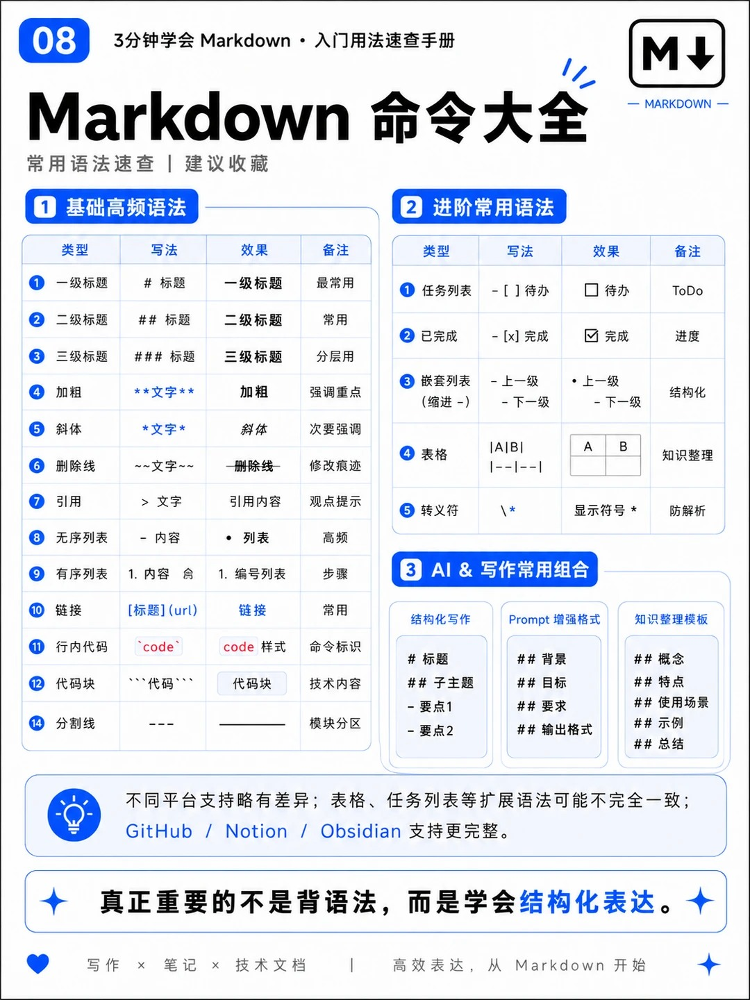

# 我是标题
## 我是二级标题
### 我是三级标题
#### 我是四级标题
---
我是一段文本
*左右加星号能让我变成斜体*
**左右加两个星号能让我变成粗体**
>尖号表示引用内容，底下那个是分割线
---
**3、列表**
**（1）无序列表**
- 苹果
- 香蕉
- 葡萄

**（2）有序列表**
1.第一步
2.第二部
3.第三步

**（3）任务列表**
- [ ] 待办事项（如你所见，敲代码的时候要注意空格）
- [x] 完成
---
**4、链接/图片/代码**
**（1）链接**
[一个deepseek对话框](https://chat.deepseek.com/a/chat/s/2f5f5760-8a36-44d9-85e3-20f2801f8264)
[一篇3分钟markdown入门的小红书]( https://xhslink.cn/o/3ThiFNifvRr )
**（2）图片**

**(3)行内代码**
这个是行内代码`code`
**(4)代码块**
```c
#include <stdio.h>
int main() {
    char ch;
    printf("请输入A：");
    ch = getchar(); 
    printf("你输入的是：%c\n", ch);
    return 0;
}
```
---
**5、进阶常用语法**
**（1）嵌套列表**
- 一级
  - 二级
  - 二级

**（2）表格**
| A | B |
|---|---|
|1  |2  |

**（3）转义符**
\* (显示符号，防解析)
